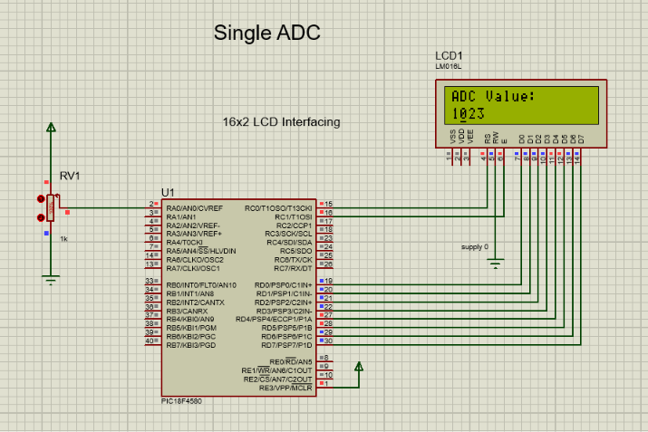
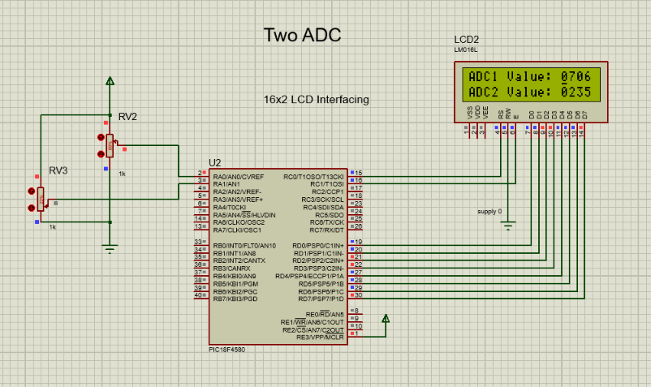

# PIC18F4580 ADC & LCD Interfacing

This repository contains **single-channel and dual-channel ADC interfacing projects** using the **PIC18F4580 microcontroller** and a **16×2 LCD**.

The projects are developed in Embedded C and tested using **Proteus simulation**.

---

## 🛠️ Tools & Technologies

- **Microcontroller:** PIC18F4580
- **Programming Language:** Embedded C
- **Compiler:** MPLAB C18
- **Simulation:** Proteus
- **Display:** 16×2 LCD
- **ADC Resolution:** 10-bit
- **Analog Inputs:** AN0 and AN1
- **LCD Interface:** 8-bit mode
- **Oscillator:** 20 MHz

---

## 📁 Project Structure

```text
PIC18F4580-ADC-LCD/
│
├── Simulation/
│   ├── adc1.png
│   ├── adc2.png
│   ├── adc_1value.pdsprj
│   └── adc_2value.pdsprj
│
├── Source_Code/
│   ├── adc_value.c
│   └── adc_2value.c
│
└── README.md
```

---

# 1️⃣ Single ADC Channel

This project reads an analog voltage from **AN0** using the
PIC18F4580's 10-bit ADC and displays the converted value on a
16×2 LCD.

### Configuration

- ADC Channel: **AN0**
- ADC Resolution: **10-bit**
- ADC Range: **0–1023**
- LCD: **16×2**
- LCD Data Pins: **PORTD**
- RS: **RC0**
- Enable: **RC1**

### Working

```text
Analog Voltage
      ↓
     AN0
      ↓
  ADC Module
      ↓
  10-bit Result
      ↓
 Decimal Conversion
      ↓
   16×2 LCD
```

### Proteus Simulation



---

# 2️⃣ Two ADC Channels

This project reads two analog inputs, **AN0 and AN1**, and displays
both ADC values on a 16×2 LCD.

### Configuration

- ADC Channel 1: **AN0**
- ADC Channel 2: **AN1**
- ADC Resolution: **10-bit**
- ADC Range: **0–1023**
- LCD: **16×2**
- LCD Data Pins: **PORTD**
- RS: **RC0**
- Enable: **RC1**

### LCD Output

```text
ADC1 Value: XXXX
ADC2 Value: XXXX
```

### Working

```text
             ┌─── AN0 ───┐
             │            ↓
Analog Input ┤         ADC Conversion
             │            ↓
             │        ADC1 Display
             │
             └─── AN1 ───┐
                          ↓
                     ADC Conversion
                          ↓
                      ADC2 Display
```

### Proteus Simulation



---

# 🔌 LCD Connections

The LCD is operated in **8-bit mode**.

| PIC18F4580 | LCD |
|---|---|
| PORTD | D0–D7 |
| RC0 | RS |
| RC1 | E |
| GND | RW |

The analog inputs are connected as:

| ADC Channel | Input |
|---|---|
| AN0 | ADC1 |
| AN1 | ADC2 |

---

# ⚙️ ADC Registers Used

### ADCON0

Used for:

- Selecting the ADC channel
- Enabling the ADC
- Starting the ADC conversion

### ADCON1

Used to configure pins as **analog or digital**.

For the dual-channel project:

```c
ADCON1 = 0x0D;
```

This configures AN0 and AN1 for analog input.

### ADCON2

Used to configure:

- Result justification
- Acquisition time
- ADC conversion clock

### ADRESH and ADRESL

The 10-bit ADC result is stored across:

```text
ADRESH + ADRESL
       ↓
  10-bit ADC Result
       ↓
     0–1023
```

---

# 🔄 ADC Conversion Process

The basic ADC operation is:

```text
Select ADC Channel
        ↓
Allow Acquisition Time
        ↓
Start Conversion
        ↓
Wait for GO/DONE = 0
        ↓
Read ADRESH & ADRESL
        ↓
Combine 10-bit Result
        ↓
Convert to ASCII
        ↓
Display on LCD
```

---

# 📊 Project Comparison

| Feature | Single ADC | Two ADC |
|---|---|---|
| Channels | AN0 | AN0 + AN1 |
| Resolution | 10-bit | 10-bit |
| ADC Range | 0–1023 | 0–1023 |
| LCD | 16×2 | 16×2 |
| LCD Mode | 8-bit | 8-bit |
| LCD Data | PORTD | PORTD |
| RS | RC0 | RC0 |
| E | RC1 | RC1 |

---

# 🎯 Learning Objectives

This project demonstrates:

- PIC18F4580 ADC configuration
- 10-bit ADC operation
- Analog channel selection
- ADC conversion using the GO/DONE bit
- Reading ADRESH and ADRESL
- Converting ADC values to decimal ASCII
- 16×2 LCD interfacing
- Single-channel ADC operation
- Multiple ADC channel operation
- Proteus-based hardware simulation

---

# 👨‍💻 Author

**Raju Malekar**

Electronics Engineer | Embedded Systems Enthusiast

### Areas of Interest

- Embedded C
- PIC Microcontrollers
- ADC Interfacing
- LCD Interfacing
- Embedded Systems
- Proteus Simulation
- Electronics & Circuit Design

---

⭐ If you find this project useful, consider giving the repository a star.
